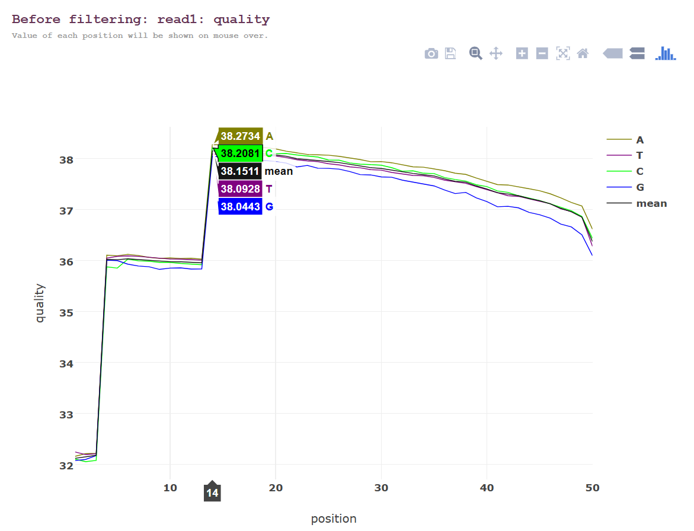
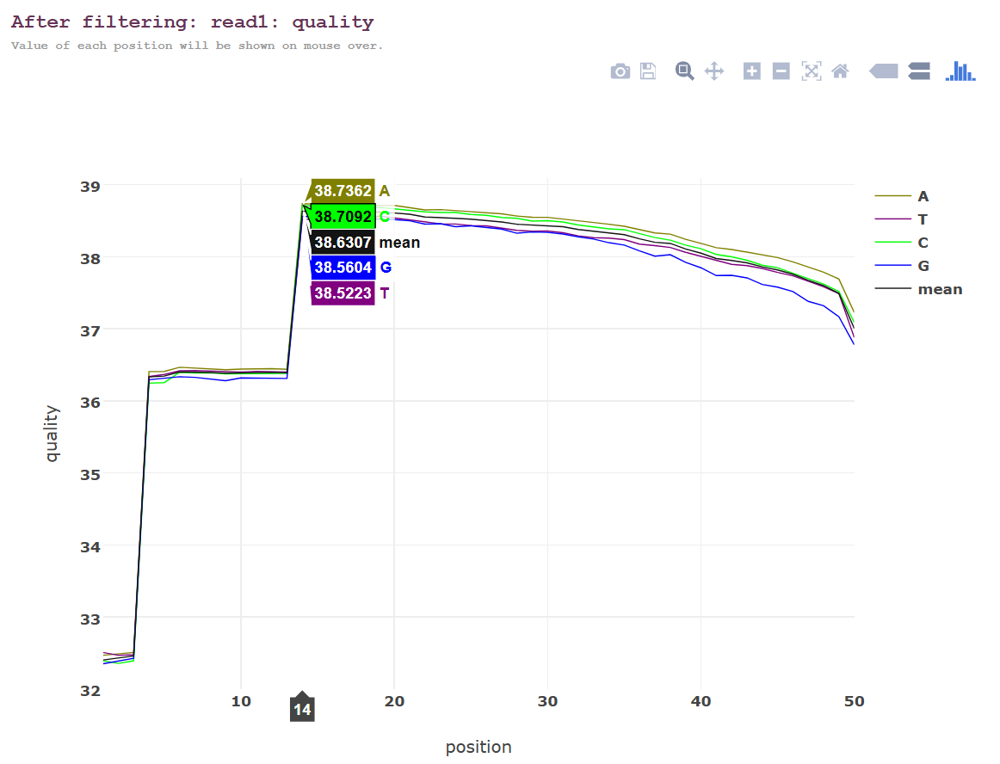
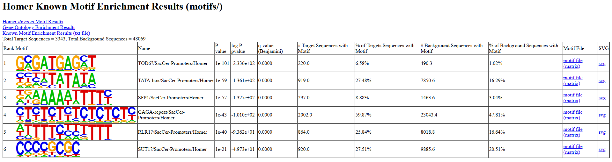
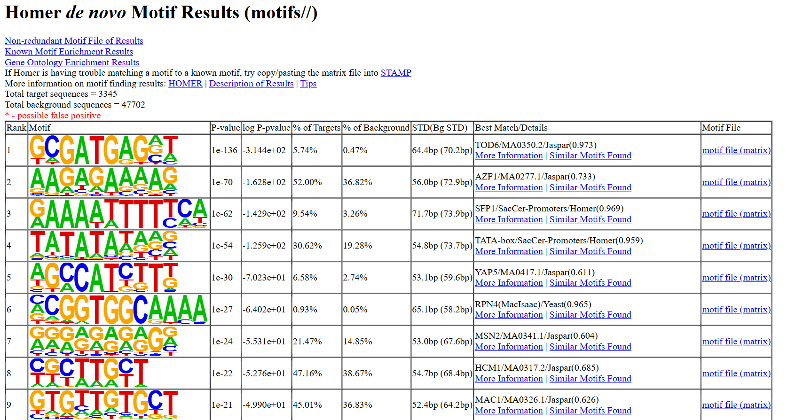

<p align="center">
  
</p>

<!-- Header -->
<p align="center">
  
</p>

<h1>Genome-Wide ChIP-seq Analysis and Transcription Factor Motif Enrichment in <i>Saccharomyces cerevisiae</i></h1>

<p align="center">
  
  
  
  
  
  
</p>

<p>
  <i>A genome-wide ChIP-seq workflow integrating sequence preprocessing, reference-based alignment, peak identification, and transcription factor motif enrichment analysis.</i>
</p>

---

## Table of Contents

<ul>
  <li><a href="#overview">Overview</a></li>
  <li><a href="#research-question">Research Question</a></li>
  <li><a href="#dataset">Dataset</a></li>
  <li><a href="#project-objectives">Project Objectives</a></li>
  <li><a href="#tools--technologies">Tools & Technologies</a></li>
  <li><a href="#project-structure">Project Structure</a></li>
  <li><a href="#pipeline-workflow">Pipeline Workflow</a></li>
  <li><a href="#how-to-run-this-project">How to Run This Project</a></li>
  <li><a href="#sequence-quality-control-and-preprocessing">Sequence Quality Control and Preprocessing</a></li>
  <li><a href="#reference-based-alignment">Reference-Based Alignment</a></li>
  <li><a href="#peak-calling-using-macs2">Peak Calling Using MACS2</a></li>
  <li><a href="#motif-enrichment-analysis-using-homer">Motif Enrichment Analysis Using HOMER</a></li>
  <li><a href="#results-summary">Results Summary</a></li>
  <li><a href="#motif-enrichment-visualization">Motif Enrichment Visualization</a></li>
  <li><a href="#future-work">Future Work</a></li>
</ul>

---

## Overview

This project presents a genome-wide ChIP-seq analysis workflow for identifying enriched DNA regions associated with transcription factor binding in *Saccharomyces cerevisiae*.

The analysis starts with raw Illumina sequencing data and applies quality control, read preprocessing, and reference-based alignment to prepare the data for downstream analysis.

MACS2 is used to identify enriched genomic regions through peak calling, while HOMER is applied to investigate known and de novo DNA sequence motifs within the identified peak regions.

The workflow combines peak identification and motif enrichment analysis to characterize the sequence patterns associated with ChIP-seq peaks.

---

## Research Question

**How can ChIP-seq analysis identify genome-wide transcription factor binding regions in *Saccharomyces cerevisiae*, and what do peak-calling and motif-enrichment results reveal about the DNA sequence patterns associated with these regions?**

This question addresses the two main components of the project:

- Identification of enriched genomic regions using MACS2.
- Detection of overrepresented DNA sequence motifs using HOMER.

---

## Dataset

| Parameter | Description |
|---|---|
| Organism | *Saccharomyces cerevisiae* |
| Sequencing Platform | Illumina |
| Input Dataset | <a href="https://trace.ncbi.nlm.nih.gov/Traces/sra/?run=SRR2155470" target="_blank">SRR2155470</a> |
| Reference Genome | *Saccharomyces cerevisiae* |
| Analysis Type | ChIP-seq |
| Primary Output | Peak files (BED) |
| Downstream Analysis | Known and de novo motif enrichment |

---

## Project Objectives

1. Process raw ChIP-seq sequencing reads through quality assessment and preprocessing.
2. Align processed reads against the *Saccharomyces cerevisiae* reference genome.
3. Identify enriched genomic regions using MACS2 peak calling.
4. Analyze known and de novo DNA sequence motifs using HOMER.
5. Examine the enrichment patterns of identified motifs within the called peak regions.

---

## Tools & Technologies

| Tool | Purpose |
|---|---|
| FastQC | Quality assessment of raw and processed sequencing reads. |
| Fastp | Adapter trimming, quality filtering, and read preprocessing. |
| BWA | Reference-based alignment of sequencing reads. |
| Samtools | SAM/BAM conversion, sorting, indexing, and alignment-file processing. |
| MACS2 | Identification of enriched genomic regions through peak calling. |
| HOMER | Known and de novo motif enrichment analysis. |
| SRA Toolkit | Downloading and converting SRA sequencing data into FASTQ files. |
| Bash | Pipeline automation and workflow management. |

---

## Project Structure

```bash
chip-seq-pipeline/
│
├── Data/                     # Raw sequencing data (.sra, FASTQ)
│
├── Genome/                   # Reference genome
│
├── Quality_Trimming/         # Fastp preprocessing results
│
├── SAM/                      # SAM alignment files
│
├── BAM/                      # Processed BAM alignment files
│
├── Macs2_Output/             # MACS2 peak-calling results
│
├── Homer_Output/             # HOMER motif analysis results
│
├── Document/                 # Workflow diagram and result images
│
└── Pipeline/                 # Pipeline scripts
```

---

## Pipeline Workflow

The analysis follows these major steps:

1. Download sequencing data from NCBI SRA.
2. Convert SRA files into FASTQ format using the SRA Toolkit.
3. Assess raw read quality using FastQC.
4. Perform adapter trimming and quality filtering using Fastp.
5. Index the reference genome using BWA.
6. Align processed reads using BWA-MEM.
7. Convert SAM files into BAM format using Samtools.
8. Sort, index, and process BAM files.
9. Identify enriched genomic regions using MACS2.
10. Perform known and de novo motif enrichment analysis using HOMER.
11. Visualize peak-calling and motif-enrichment results.

<p align="center">
  <a href="https://github.com/genome-miner/chip-seq-pipeline/blob/main/Document/Pipeline.png" target="_blank">
    View Pipeline Visualization
  </a>
</p>

---

## How to Run This Project

### 1. Clone the Repository

```bash
git clone https://github.com/genome-miner/chip-seq-pipeline.git

cd chip-seq-pipeline
```

### 2. Download Sequencing Data

Use the SRA Toolkit to retrieve the sequencing dataset:

```bash
prefetch SRR2155470
```

Convert the downloaded SRA data into FASTQ format using `fasterq-dump` or `fastq-dump`.

### 3. Run the Analysis Pipeline

Navigate to the Pipeline directory:

```bash
cd Pipeline
```

Run the available pipeline scripts in the required order.

### 4. Explore the Results

The main output directories include:

- `Quality_Trimming/` for Fastp preprocessing results.
- `Macs2_Output/` for MACS2 peak-calling results.
- `Homer_Output/` for HOMER motif enrichment results.

---

## Sequence Quality Control and Preprocessing

Raw sequencing reads were assessed using FastQC to examine their initial quality characteristics.

Fastp was then used for adapter trimming and quality filtering to prepare the sequencing reads for downstream alignment.

The before and after filtering outputs provide a visual comparison of read quality following preprocessing.

<p align="center">
  
</p>

<p align="center">
  
</p>

---

## Reference-Based Alignment

The processed sequencing reads were aligned against the *Saccharomyces cerevisiae* reference genome using BWA-MEM.

Samtools was used to process the resulting alignment files, including SAM-to-BAM conversion, sorting, and indexing.

The processed BAM files served as input for downstream MACS2 peak calling.

---

## Peak Calling Using MACS2

MACS2 was used to identify enriched genomic regions from the aligned ChIP-seq data.

Peak calling identified **3,343 genomic peaks**, representing regions of enrichment in the analyzed sequencing data.

The reported peak characteristics included:

- Sharp, promoter-proximal enrichment patterns.
- Approximate peak lengths of 250–300 bp.
- Predominant representation of promoter-associated regions.

These results provide the genomic regions used for subsequent motif enrichment analysis.

---

## Motif Enrichment Analysis Using HOMER

HOMER was applied to investigate known and de novo DNA sequence motifs within the identified peak regions.

The analysis identified several enriched motifs, including TOD6, TATA-box, SFP1, GAGA-repeat, RLR1?, and SUT1?.

Motif enrichment was evaluated by comparing the percentage of target peak sequences containing each motif against the corresponding background percentage.

The resulting enrichment patterns highlight DNA sequence motifs that occur more frequently within the analyzed peak regions.

---

## Results Summary

### MACS2 Peak Calling

| Metric | Result |
|---|---:|
| Total Peaks Identified | 3,343 |
| Peak Characteristics | Sharp, promoter-proximal |
| Approximate Peak Length | 250–300 bp |
| Genome Distribution | Predominantly promoter regions |

### HOMER Motif Enrichment

| Rank | Motif | Target Peaks (%) | Background (%) | P-value |
|---:|---|---:|---:|---:|
| 1 | TOD6 | 6.58 | 1.02 | 1e-101 |
| 2 | TATA-box | 27.48 | 16.29 | 1e-59 |
| 3 | SFP1 | 8.88 | 3.04 | 1e-57 |
| 4 | GAGA-repeat | 59.87 | 47.81 | 1e-43 |
| 5 | RLR1? | 25.84 | 16.64 | 1e-40 |
| 6 | SUT1? | 27.51 | 20.51 | 1e-21 |

The reported p-values indicate statistically significant enrichment of the listed motifs in the target peak sequences relative to the background sequences.

---

## Motif Enrichment Visualization

HOMER generated motif logos and enrichment visualizations to represent the sequence patterns identified during the analysis.

These visualizations provide a graphical representation of enriched motifs and their occurrence within target peak sequences.

### Motif Enrichment Results

<p align="center">
  
</p>

### De Novo Motif Discovery

<p align="center">
  
</p>

---

## Future Work

1. **Functional Annotation:** Associate identified peak regions with nearby genes to investigate their potential regulatory context.
2. **Comparative ChIP-seq Analysis:** Compare transcription factor binding patterns across different experimental conditions.
3. **Integration with RNA-seq:** Combine motif and peak information with gene-expression data to investigate potential relationships between DNA binding and transcriptional changes.
4. **Extended Motif Analysis:** Investigate additional ChIP-seq datasets and transcription factors to compare motif enrichment patterns.
5. **Regulatory Network Analysis:** Integrate additional experimental evidence to investigate potential transcriptional regulatory relationships.

---

## License
This project is licensed under the [MIT License](https://github.com/genome-miner/chip-seq-pipeline/blob/main/LICENSE).

---

<h2 id="contact">👩‍💻 Author and Contact</h2>

**Sana Aziz Sial**  
Biotechnologist and Bioinformatician
- 🎓 [University of Veterinary and Animal Sciences](https://www.uvas.edu.pk/)
- 📧 [Email](sanaazizsial@gmail.com)
- 🐙 [GitHub](https://github.com/genome-miner)
- 🔗 [LinkedIn](in/sana-aziz-sial-73b189265)


<p align="center">
  <b>Thank you for visiting this repository!</b>
</p>
